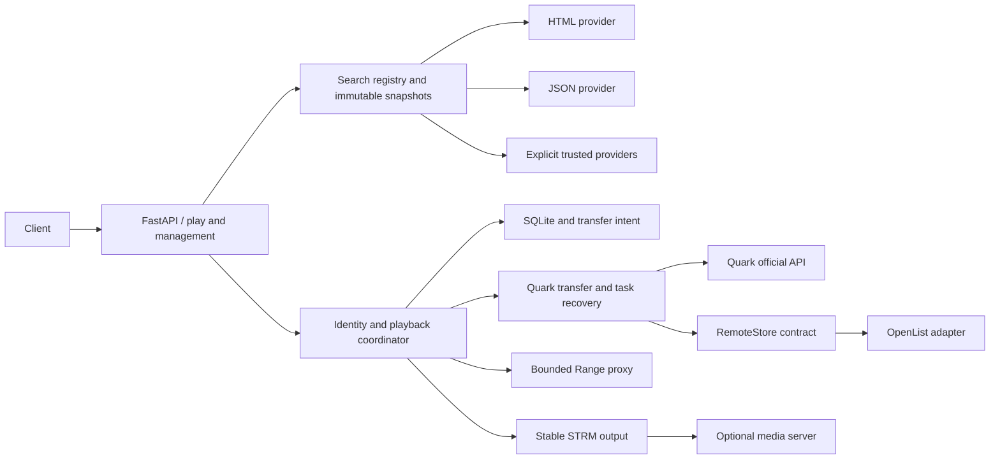

# Architecture

Quark-VOD has a standalone FastAPI API, a shared playback/state core and optional
external integrations.

Remote storage operations used by the transfer lifecycle sit behind the small
`RemoteStore` contract; write operations use the write mount, while direct-link
and refresh operations use the playback mount. The default adapter wraps OpenList.
Quark share parsing, official save tasks and account authorization remain in the transfer component,
so this seam does not yet make arbitrary cloud drives drop-in backends.

## State and identity

The data base is configurable and contains state, locks and optional STRM output.
Movie/episode identity is checked before quality ordering. Exact directory
context can disambiguate numeric/translated episode names; conflicting years,
seasons, sequels and multi-episode files remain rejected.

A transfer intent is persisted before uncertain upstream work. Retry restores
or resolves that intent before submitting another save. The completed-save
state is distinct from readable/activated playback.

## Playback

Standalone mode resolves a ready playback URL directly and does not generate
STRM files. Enabling Jellyfin integration requires an existing stable STRM
mapping for the requested movie/episode; it cannot silently invent a library item.

In Jellyfin mode, STRM points to stable `/play` routes rather than transient signed media URLs.
MP4 range caching is bounded in memory and upstream concurrency. A source version
change prevents reuse of another saved object's bytes. Disconnect and error
paths release capacity.

## Optional integrations

OpenList and Quark authorization are required for actual remote saving/read
resolution. Jellyfin refresh/protection, AI weak-name assistance, initial scans,
write probes, background self-healing and destructive maintenance are opt-ins.

Disabling Jellyfin does not authorize destructive operations. Maintenance stays
disabled unless explicitly enabled with a working protection integration.
Unknown account state, sessions, protection data or incomplete enumeration must
stop destructive work.

## Search runtime

Providers are selected through versioned JSON. Each search retains one immutable
snapshot; validated replacements affect new requests. Configuration fingerprints
partition cache entries. Bad replacements retain the previous valid snapshot.

Trusted installed Python providers are explicitly allowlisted. Installing code
and reloading data configuration are separate operations.

## Deployment

One process and one worker serve a state directory. The public container is
non-root with a read-only root filesystem, a persistent writable data mount and
a small temporary mount. Legacy host-path layouts can be preserved through a
local integration override without putting those paths in the public defaults.

Wheel, source and container artifacts are built independently of private account
data and do not bundle legacy FFmpeg/jq binaries.
