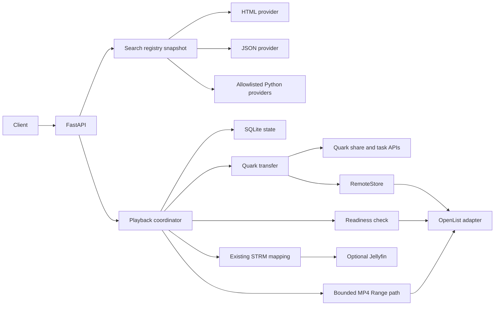

# Architecture

Quark-VOD is a single-process FastAPI service for discovering Quark shares,
saving selected media, and resolving playback. Search providers are configurable;
Quark authorization and save-task handling remain part of the core. OpenList is
the current adapter for remote storage and playback URLs.

## Transfer and storage

Search returns share candidates. Before saving, the core checks work identity and
selects a matching file; a larger file or a quality label cannot override a
conflicting title, year, season, or episode. Quark share parsing, account
authorization, official save requests, and task polling stay in
`QuarkTransfer`.

Episode basenames in an unknown Latin translation may inherit an exact work
label from their enumerated parent directory only after season, episode, year,
and technical suffix checks. Generic release-group suffixes are allowed, while
explicit cut/edition labels such as Director's Cut, Theatrical, Extended, Unrated,
Remastered, and numbered Version labels remain identity conflicts. The checks
apply before release-group removal and also preserve known title/version
conflicts; a release-group prefix alone is not an edition label.

The service records a save intent before submitting an uncertain remote write.
If a request times out or the process restarts, the next attempt checks the
recorded target and task ID before it can submit another save. Before renaming a
confirmed saved file, it also persists the stable Quark file ID, so recovery
can locate that exact file after a rename even if the process stops before
committing completion. Completion and its expiry queue entry share one
SQLite transaction. A completed save
is recorded separately from playback readiness and Jellyfin activation.
The management reset endpoint returns HTTP 409 while a save intent remains
unresolved and preserves its recovery state and playback entry. Resume the
original transfer flow to resolve the persisted task before resetting; a reset
is available once the intent is terminal and its recovery fields are clear.

`RemoteStore` is intentionally small. Its four operations are `mkdir`,
`direct_url`, `refresh_path_tree`, and `remove`. Directory creation and deletion
use the configured write-mount namespace; direct URLs and refreshes use the
playback-mount namespace. A rejected create or delete stops the lifecycle.
Refresh is advisory and does not prove that a file exists. The current adapter
wraps OpenList. This boundary does not make other cloud drives interchangeable:
Quark account access, share inspection, and save tasks are still Quark-specific.

## State and coordination

SQLite stores transfer state, save-task recovery data, STRM mappings, playback
access, and cleanup work. The legacy `plays` statistic is an access-session
count, also exposed as `playback_access_sessions`; it does not prove watch time
or completion. Expiry cleanup also relies on Jellyfin progress, never on an
uncompleted access-session record. Each request refreshes retention, but repeated Range requests for
the same transfer count only once until there has been a 30-minute access gap.
Existing historical events are retained. Automatic preheat/import/play markers
cannot overwrite an existing explicit pin. State-write failures propagate and
log only the operation and exception type, without media or credential values.
SQLite uses WAL mode. The state database can be
configured independently; cross-process lock files live under
`VOD_DATA_DIR/locks`, and the optional media-library root has its own
`VOD_CINEMA2_DIR` setting.

`app/quark_vod/db.py` owns the monotonic schema version in SQLite
`PRAGMA user_version`. Schema version 2 adds the nullable save_file_fid
recovery field to existing databases without changing version-1 migration SQL.
A version-0 database from the supported legacy schema is
checked with SQLite `quick_check` and upgraded transactionally during application
startup, before stale-transfer cleanup or background work begins. Startup
validates the required tables and columns; a failed integrity check or incomplete
migration aborts startup and rolls back its transaction. Already-current
databases do not incur the integrity scan on routine startup. A database from a
newer schema version is rejected without application schema or data changes. The
service does not perform automatic downgrades or create backups; operators must
make and verify an SQLite online backup before upgrading. Restoring an older
database is an explicit recovery decision because it discards state written after
that backup.

The supported service topology is one process and one ASGI worker. Resolver
reservations, semaphores, and caches are process-local; they are not a distributed
job queue. Host-side jobs that share a library must also use the data directory's
lock files so maintenance cannot race playback or another maintenance run.
Upgrades are single-writer operations, not rolling deployments: stop every old
service process and host-side state writer before starting a new version. Startup
locking serializes schema initialization, but it cannot prevent an already-running
older binary from continuing to write after a migration. Schema changes that need
overlap require an explicitly staged, backward-compatible migration.

## Playback modes

Without Jellyfin integration, a successful resolution returns a verified media
URL and does not create or modify STRM files. With Jellyfin enabled, the work
must map to an existing, identity-matched STRM file. The STRM contains a stable
`/play` route that resolves the saved object again instead of retaining a
short-lived signed media URL.

MP4 playback can use the `/media` Range path. It reads 512 KiB blocks, retains at
most 24 MiB in the process cache for five minutes, and permits four simultaneous
upstream block reads. The HTTP layer admits at most 32 concurrent streams across /media and
/clean, and releases capacity on HEAD, failures, and client disconnects.
/health runs asynchronously and does not need a synchronous worker token.
It does not download or cache an entire movie. A source identity/version change
prevents blocks from a previous saved object being reused.

## Search and integrations

Search configuration is versioned JSON. Each request uses one immutable
registry snapshot; a valid replacement affects later requests, and an invalid
replacement keeps the last valid snapshot. Python provider code is trusted code
and must be explicitly allowlisted. Installing provider code is separate from
reloading JSON configuration. See [Search plugins](plugins.md) for the schema,
provider contract, limits, and reload behavior.

OpenList API responses are bounded to 8 MiB; oversized, malformed, or failed
responses remain errors and are not treated as empty directories. Concurrent
requests rejected with the same token share one serialized login refresh, then
retry once with the current token. API login and upload requests reject redirects
instead of forwarding credentials or changing write semantics. Error messages
omit server response bodies.

Search results retain their existing TTL (30 minutes for complete nonempty
results, 45 seconds for partial or empty results). Expired disk hits are removed
immediately. Writes also sweep regular `ps4_*.json` files older than the maximum
TTL at most once per minute, preserving unrelated files and symlinks.

Saving a new item requires Quark credentials and a reachable OpenList. Resolving
an item already saved in service state requires that state and an OpenList address
reachable by both the service process and the player; it does not require another
Quark save request. Search requires an enabled, reachable provider. The API can
start without these account credentials or providers. Jellyfin, startup scans,
self-healing, and write probes are optional integrations controlled by explicit
settings. A health response only proves that the HTTP service is responding.

## Security and maintenance

`/health` is public. Administrative APIs, `/stats`, `/capability`, and
`/preheat` require a configured Bearer token. Playback routes are intended for a
trusted network and are not a user authentication system; deployments exposed
outside that boundary need a restricted network or an authenticated proxy. See
[Security](../SECURITY.md).

Destructive maintenance is disabled by default. Enabling it also requires the
Jellyfin protection integration. Maintenance takes an exclusive shared lock,
checks the Jellyfin session and protection state, and stops when those checks
are missing or uncertain. Incomplete remote enumeration is not deletion
evidence. STRM restoration must succeed before remote deletion, and failed
deletions retain retry state.

Quota retention protects Jellyfin favorites, items with unfinished playback
progress, and explicit user pins. Completed watch history and temporary
preheat/import markers are not permanent pins. A playback access in the last
six hours receives a temporary grace period; other eligible title directories
are considered least-recently-used first, using `playback_access` timestamps
and falling back to legacy `plays` timestamps. Never-accessed items sort first,
with larger directories first when access times tie. The complete directory inventory validates leaf names, types and nonnegative
byte counts; malformed entries stop eviction. Any overlapping unfinished save
intent or non-done reference preserves the directory, including references from
a different title, year or category. An intent without a resolvable target stops
all cloud deletion entirely. Unresolved-path checks are shared by quota, expiry
and mismatched-package cleanup. The LRU ranking applies to
quota eviction; other cleanup jobs keep their own protection checks.

Startup STRM registration collects a complete library snapshot before writing,
then commits the mapping batch once. It removes only mappings to confirmed
missing files under the same available root; enumeration errors preserve the
old mapping state. Search ranking remains deterministic and share-based: unused
CMS playback helpers and the unconnected AI title-review module have been
removed. AI filename parsing is still opt-in, and reasoning_effort is sent
only when AI_PARSE_REASONING_EFFORT is explicitly nonempty.

The command cleanup --enforce-quota retains its quota/mismatch-only scope.
Operators who also want the expiry queue drained must add --with-expiry;
this is an explicit schedule change. Image cleanup remains separate and
requires its configured metadata roots and a completed library scan.

## Deployment

The CLI starts one Uvicorn worker. The public Compose service runs as UID 10001
with a read-only root filesystem, a persistent `/data` volume, and a 32 MiB
`/tmp` tmpfs. It drops all Linux capabilities, enables `no-new-privileges`, and
limits the container to 256 MiB of memory and 128 processes. These defaults are
part of the supported deployment model; see [Installation and operations](quickstart.md).

Orphan Jellyfin metadata pruning is a separate opt-in: configure both
`JELLYFIN_METADATA_LIBRARY_DIR` (the mounted local library directory) and
`JELLYFIN_METADATA_LIBRARY_PREFIX` (the absolute library prefix stored in
Jellyfin image paths). No host layout is assumed. The full image-reference table
is read; remote HTTP(S) images are unrelated to local files, while an unmapped
local path stops the operation. The existing complete-tree, reference-count,
permission and changed-file checks still apply.

### Explicit image reference namespaces

Destructive metadata maintenance requires JELLYFIN_METADATA_LIBRARY_DIR and
JELLYFIN_METADATA_LIBRARY_PREFIX. Both default to empty. Additional local image
namespaces have no implicit host mapping. Operators may explicitly set
JELLYFIN_METADATA_EXTERNAL_ROOTS to a JSON array such as:

    [{"prefix":"/metadata/actors","root":"/srv/images/actors"}]

The default is [] (no exclusions). Each prefix and root must be an absolute,
normalized non-root path. Database prefixes and resolved local roots must be
pairwise disjoint, including the configured library mapping. Unknown fields,
duplicate or overlapping mappings, missing roots, permission/resolve errors and
parent traversal stop cleanup. Every excluded local reference must resolve
strictly inside its declared external root and outside the library. Existing
objects must be regular files; missing external images are allowed only after
that boundary is proven, including resolution of existing symlinks and parents. Symlinks escaping that root are rejected. Configuration does not
grant filesystem permissions or mount directories; operators must verify the
database paths, actual mounts and file visibility for the executing process.
Unknown namespaces remain fail-closed. No provider-specific People/Studio paths
are built in. Remote HTTP(S) image references retain their existing handling.
