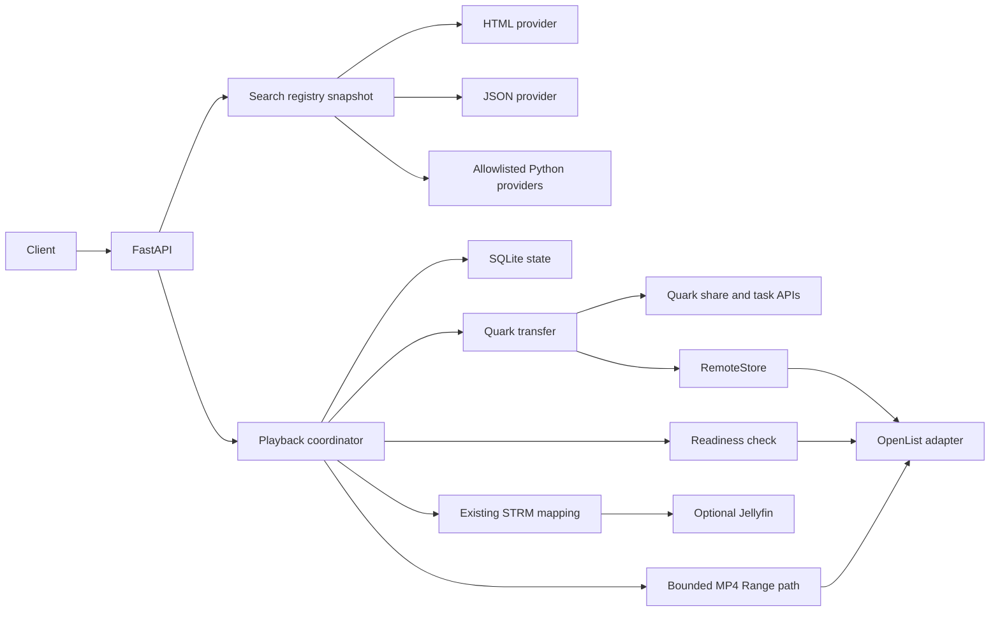

# Architecture

Quark-VOD is a single-process FastAPI service for discovering Quark shares,
saving selected media, and resolving playback. Search providers are configurable;
Quark authorization and save-task handling remain part of the core. OpenList is
the current adapter for remote storage and playback URLs.

## Transfer and storage

Search returns share candidates. Before saving, the core checks work identity and
selects a matching file; a larger file or a quality label cannot override a
conflicting title, year, season, or episode. Quark share parsing, account
authorization, official save requests, and task polling stay in
`QuarkTransfer`.

The service records a save intent before submitting an uncertain remote write.
If a request times out or the process restarts, the next attempt checks the
recorded target and task ID before it can submit another save. A completed save
is recorded separately from playback readiness and Jellyfin activation.

`RemoteStore` is intentionally small. Its four operations are `mkdir`,
`direct_url`, `refresh_path_tree`, and `remove`. Directory creation and deletion
use the configured write-mount namespace; direct URLs and refreshes use the
playback-mount namespace. A rejected create or delete stops the lifecycle.
Refresh is advisory and does not prove that a file exists. The current adapter
wraps OpenList. This boundary does not make other cloud drives interchangeable:
Quark account access, share inspection, and save tasks are still Quark-specific.

## State and coordination

SQLite stores transfer state, save-task recovery data, STRM mappings, playback
access, and cleanup work. SQLite uses WAL mode. The state database can be
configured independently; cross-process lock files live under
`VOD_DATA_DIR/locks`, and the optional media-library root has its own
`VOD_CINEMA2_DIR` setting.

The supported service topology is one process and one ASGI worker. Resolver
reservations, semaphores, and caches are process-local; they are not a distributed
job queue. Host-side jobs that share a library must also use the data directory's
lock files so maintenance cannot race playback or another maintenance run.

## Playback modes

Without Jellyfin integration, a successful resolution returns a verified media
URL and does not create or modify STRM files. With Jellyfin enabled, the work
must map to an existing, identity-matched STRM file. The STRM contains a stable
`/play` route that resolves the saved object again instead of retaining a
short-lived signed media URL.

MP4 playback can use the `/media` Range path. It reads 512 KiB blocks, retains at
most 24 MiB in the process cache for five minutes, and permits four simultaneous
upstream block reads. The HTTP layer admits at most 32 concurrent media streams.
It does not download or cache an entire movie. A source identity/version change
prevents blocks from a previous saved object being reused.

## Search and integrations

Search configuration is versioned JSON. Each request uses one immutable
registry snapshot; a valid replacement affects later requests, and an invalid
replacement keeps the last valid snapshot. Python provider code is trusted code
and must be explicitly allowlisted. Installing provider code is separate from
reloading JSON configuration. See [Search plugins](plugins.md) for the schema,
provider contract, limits, and reload behavior.

Saving a new item requires Quark credentials and a reachable OpenList. Resolving
an item already saved in service state requires that state and an OpenList address
reachable by both the service process and the player; it does not require another
Quark save request. Search requires an enabled, reachable provider. The API can
start without these account credentials or providers. Jellyfin, startup scans,
self-healing, and write probes are optional integrations controlled by explicit
settings. A health response only proves that the HTTP service is responding.

## Security and maintenance

`/health` is public. Administrative APIs, `/stats`, `/capability`, and
`/preheat` require a configured Bearer token. Playback routes are intended for a
trusted network and are not a user authentication system; deployments exposed
outside that boundary need a restricted network or an authenticated proxy. See
[Security](../SECURITY.md).

Destructive maintenance is disabled by default. Enabling it also requires the
Jellyfin protection integration. Maintenance takes an exclusive shared lock,
checks the Jellyfin session and protection state, and stops when those checks
are missing or uncertain. Incomplete remote enumeration is not deletion
evidence. STRM restoration must succeed before remote deletion, and failed
deletions retain retry state.

## Deployment

The CLI starts one Uvicorn worker. The public Compose service runs as UID 10001
with a read-only root filesystem, a persistent `/data` volume, and a 32 MiB
`/tmp` tmpfs. It drops all Linux capabilities, enables `no-new-privileges`, and
limits the container to 256 MiB of memory and 128 processes. These defaults are
part of the supported deployment model; see [Installation and operations](quickstart.md).
