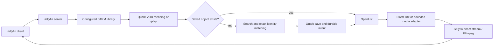

# Unified cinema architecture

Quark-VOD 3.2 is an alpha candidate integrating the project-owned cinema code.
The package now owns playback, the authenticated cinema page, task execution,
AI routing settings and optional Jellyfin wrappers. Jellyfin, OpenList, FFmpeg,
search providers, TMDB and Quark remain independent components.

## Code and process ownership

| Code | Owner and runtime |
| --- | --- |
| `app/main.py`, `app/quark_vod/server.py` | Single-worker HTTP API and immediate playback coordination |
| `static/admin.html`, `cinema_api.py` | Cinema, source inspection, subscriptions and management in one administration page |
| `automation_settings.py`, `automation_api.py` | Authenticated, revisioned task and AI configuration |
| `automation_runner.py` | Independent scheduler/worker and durable bounded task history |
| `integrations/hometheater` | Packaged, optional library discovery, sync, maintenance and AI jobs |
| `integrations/jellyfin/scripts` | Project-owned FFmpeg/ffprobe shell wrappers; no third-party binaries |

The web process does not start scheduled jobs. It queues explicit requests for
the independent worker. Playback resolvers and cinema add operations retain
their bounded immediate-operation pools. Workers and the API share the same
data directory, settings, state schema and cross-process library/work locks.
Do not run old and new schedulers for the same library.

## Playback

The optional wrapper resolves STRM redirects and adjusts network/probe options,
then invokes an independently installed upstream FFmpeg/ffprobe binary. Quark-VOD
does not implement video codecs. MP4 cache blocks and header correction remain
bounded and use the configured OpenList starting point.

## Integration boundaries

TV/IPTV aggregation and the general Homelab Hub are not moved into this package.
A dashboard may embed or link to the unified administration page. Legacy
traditional-library sync is available as an explicit optional integration; it
requires its own library paths, credentials and host tools. No host filesystem
layout, private model ID, search site or account is implied.

Jellyfin protection, save-intent recovery, precise-file selection, atomic metadata
replacement, work locks and playback leases continue to gate mutations. Missing
protection data stops cleanup. External online SQLite is read-only, including WAL.
Quark recycle-bin cleanup is outside this integration.

## API and access

Cinema uses `/api/admin/cinema/*`; tasks use `/api/admin/automation*`. Both require
the configured Bearer administrator token. The browser retains the token in
memory only, uses authenticated fetch/polling and never puts it in a URL or
EventSource query. Management settings are private data, not source files.

The packaged UI accepts a reverse-proxy root prefix. The Jellyfin deep link is
shown only with explicit `VOD_JELLYFIN_PUBLIC_URL`. It must be reachable by the
actual client. Health, configuration and fixture success do not prove playback
or access from the user's device.
